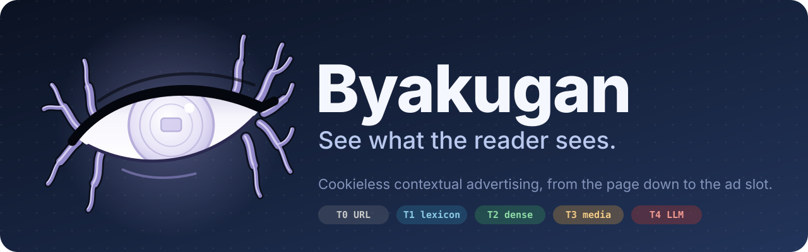

[](https://doi.org/10.5281/zenodo.24157748)
[](https://github.com/gabrielmougard/byakugan/blob/main/LICENSE)


# Byakugan

**Cookieless contextual advertising that reads the page the way the reader does: down to the ad slot.**

Third-party cookies are going away. What's left is the page. But a bidder has a few milliseconds per bid, millions of pages a day, a fixed taxonomy of 704 categories, and a trader who will ask *"why did my ad not run there?"*.

Byakugan crawls the pages a bidder sees, busiest first. It labels each one with a **budgeted cascade**: five tiers, from the URL alone to a small LLM, and a page only pays for the next tier while it's still in doubt. The bidder then reads the result inside the bid in **nanoseconds**. And it doesn't stop at the page. When the page tells it what surrounds the slot, Byakugan computes **the slot's own context**, so a sensitive headline sitting in the "Most read" widget next to your ad is never averaged away by the 2,000 words of recipe above it.

📄 **[Read the paper (PDF)](paper/out/main.pdf)**, [doi:10.5281/zenodo.24157748](https://doi.org/10.5281/zenodo.24157748): *Byakugan: seeing what the reader sees. Budgeted classification cascades and slot-level context boundaries for cookieless contextual advertising.*

## In numbers

| | |
|---|---|
| **0.501** hierarchical F1 with the LLM on only **29.8%** of pages | on a 383-page golden set in four main languages, tuned per language |
| **~$42 per million pages** | the whole cascade at the level the bidder reads, LLM included |
| **9 ns**, zero allocations | a curated deal's context check in the Go SDK (`Rule.Check`) |
| **83 ns**, zero allocations | decoding a profile from protobuf (`Profile.Decode`) |
| **1.8 µs** | a slot's own context from the blocks around it (`Profile.AtSlot`) |
| **~2×** | how much more often buyers bid on pages that match their deal's context, measured offline on bid logs |
| **~160,000 pages a day** | crawled and classified by three Raspberry Pi 4 boards (T4 off) |
| **0 mismatches in 1.1M texts** | our C tokenizers against Hugging Face's, under Model2Vec on ggml |
| **4.6×** precision | what calibration did for the cheap tiers (`standard`: 0.097 → 0.448) |

Every number is measured, and the paper says how. What isn't measured yet is in [What's not proven](#whats-not-proven).

## Why it's different

- **The LLM is the last resort, not the first.** Cheap tiers settle most pages. The LLM only reranks a 12-label shortlist, and only when the page is worth it. A page's budget follows its traffic, so the long tail costs almost nothing and hot articles get the deep treatment on their own.
- **Every label carries its evidence.** Tier, page zone, verbatim quote, reason. LLM quotes are *checked against the page*: an unverifiable quote halves the confidence, and an invented category id is dropped. LLM rationales alone aren't explanations.
- **Slot, not just page.** Relevance blends the page with the blocks near the slot through a kernel that depends on the ad format. Suitability takes the **worst case over everything on screen with the ad**. Those are two different questions, and averaging them is how brand-safety incidents happen.
- **No user data. At all.** Inputs are the page and the slot. No cookie, device id or browsing history ever enters a profile or a decision.
- **A polite crawler.** RFC 9309 through Google's reference matcher, an unreachable robots.txt counts as a refusal, at least one second between requests per host, and conditional GETs. Before any page text reaches an LLM, an **AI-use gate** reads the publisher's aipref, Content Signals and RSL licence, and any refusal wins.
- **Real systems code.** OCaml 5 with Lwt for I/O and Domainslib for CPU. Neural models run in C on vendored ggml (Model2Vec, SigLIP 2), HTML goes through lexbor, and robots.txt through Google's matcher. Each piece is checked against its reference implementation.

## What a trader sees

A profile is a set of IAB labels, each with the evidence behind it:

```text
0.90  Food & Drink › Alcoholic Beverages
      T1  title      "wine"    "Wine pairing for the big match"
      T1  body       "wine"    "Which red wine goes with a football supper?"
      T2  semantic   page cosine 0.88
      T4  verified   "Which red wine goes with a football supper?"
```

And a refusal names its reason (illustrative):

```text
deal  "Premium beer, sports"   →  UNSUITABLE
      Sensitive Topics › Crime
      the "Most read" widget 0.4 viewport below the slot shows
      "Man arrested after fatal stabbing"
```

## How it works

```text
            OFFLINE (crawler replicas, state in Valkey)                    ONLINE (inside the bid)

 crawl request on a miss ─┐                                      bid request ──► Go SDK
 news sitemaps (10 min) ──┼─► frontier ─► fetch ─► extract          │   page ─► section ─► site   (one GET per level)
 daily traffic per page ──┘   busiest     robots   zones, blocks,   │   + slot context from the Prebid module
                              first       AI gate  ad containers    ▼
                                                     │           Rule.Check ─► eligible / blocked /
                                                     ▼                          unsuitable / off-target
        ┌──────── budgeted cascade: stop as soon as the page is settled ────────┐   + the label that decided
        │ T0 URL+hints │ T1 lexicon │ T2 embeddings │ T3 images │ T4 LLM rerank │
        │     $0       │   $1e-6    │     $5e-6     │ $1e-4/img │  $1.4e-4/call │
        └──────────────────────────────────────┬────────────────────────────────┘
                                               ▼
                       profile (labels + evidence) ─► Valkey/Redis ─► read by the bidder
```

| Tier | Reads | Cost per page |
|---|---|---|
| **T0** URL and hints | URL path words, sitemap and bid-request hints, no fetch | $0 |
| **T1** lexicon | weighted terms over the title, headings, body, metadata and JSON-LD | $1×10⁻⁶ |
| **T2** dense | Model2Vec page and sentence embeddings against 704 prototypes | $5×10⁻⁶ |
| **T3** media | video titles, plus up to 3 images through SigLIP 2, zero-shot | $1×10⁻⁴ per item |
| **T4** LLM | a condensed page and a 12-label shortlist; must quote the page | $1.4×10⁻⁴ per call |

Four presets run the same cascade at different depths: `zero_fetch` (URL only), `standard` (CPU only), `rich` (spends what the page earns; what the bidder reads) and `deep` (everything re-checks everything; golden sets and audits).

## In the bidder

```go
import "github.com/gabrielmougard/byakugan/sdks/go/contextual"

// preprocessing: page, else section, else site
level, err := reader.LookupWithBackoff(ctx, normalizedURL, &req.Contextual)

// "placement list OR context", inside the placement check
func placementOK(deal *Deal, req *BidRequest) bool {
	if deal.Placements.Contains(req.PlacementID) {
		return true
	}
	return deal.ContextRule != nil && req.ContextualLevel != contextual.NotFound &&
		deal.ContextRule.Check(&req.Contextual).Verdict == contextual.Eligible
}
```

On a miss, `CrawlRequests.Request` asks the crawler for the page without blocking the bid, so a busy new article can be profiled within its first hour. The SDK's README, in `sdks/go/`, covers the rest: slot context, GPIDs and the fixtures shared with the OCaml side.

## Quick start

```bash
# needs a C++17 compiler for Google's robots.txt matcher (src/vendor, src/stubs)
opam install domainslib cohttp-lwt-unix curl_lwt melange reason reason-react reason-react-ppx
npm --prefix src/frontend install && src/fetch-data.sh
dune build --root src @default @frontend && npm --prefix src/frontend run build
dune test --root src --force
docker run -d --name contextual-valkey -p 6379:6379 valkey/valkey:9.1.3   # shared state
cd src
./_build/default/crawler/crawler.exe &   # :8081, add --llm z-ai/glm-5.3-flash for T4
./_build/default/online/online.exe       # open http://localhost:8080
```

Then open the **Placement Lab**. It replays any crawled page with scripts off, at phone or desktop width, and draws every block's score, the candidate slots, the context kernel and the co-visible window on top. Describe a creative in words and it ranks the slots.

More in the guide: [Quick start](docs/guide/quickstart.md) · [Placement Lab](docs/guide/placement-lab.md) · [HTTP APIs](docs/guide/api.md) · [Configuration](docs/guide/configuration.md) · [Deploy on k3s](docs/guide/deploy.md) · [Code map](docs/guide/code-map.md)

## What's not proven

We'd rather say it here than have you find it:

- **The golden labels were judged by an LLM**, not people, and T4 is an LLM too. A 50-page human check is next.
- **The ~2× bid lift is observational.** It says buyers value the match, not that ads perform better on it.
- **The slot model's weights are hand-set priors.** The A/B test that would fit them (page context against slot context, crossed with format, with sample sizes) is designed in the paper and has not run.
- **The bidder integration is open.** The SDK is tested against shared fixtures, but it isn't wired into a production bidder yet.

The open work is in **[ROADMAP.md](ROADMAP.md)**.

## Repository layout

| Path | What's in it |
|---|---|
| `src/` | The OCaml implementation: the library, the crawl daemon (Lwt + Domainslib, scales out through Valkey), the online placement server, the Placement Lab front end (ReasonML) and the T4 benchmark ([code map](docs/guide/code-map.md)) |
| `sdks/go/` | **Go SDK** for the bidder: profile key, reader and zero-allocation decoder, curated deals' context check, slot context (`AtSlot`, `SlotOfGPID`) and non-blocking crawl requests |
| `sdks/prebid/` | **Prebid.js module**: writes the SimHashes and offsets of the 12 blocks nearest each slot into `ortb2Imp.ext.data.ctx`. No page text leaves the page |
| `paper/` | The paper, in LaTeX with TikZ figures; `make` builds `paper/out/main.pdf` |
| `deploy/` | Helm charts for a k3s cluster (in-cluster registry, Valkey with Sentinel, crawler, online server) and `deploy.sh` for arm64 images ([guide](docs/guide/deploy.md)) |
| `docs/` | Docusaurus site rendering this README, the roadmap, `study/` and the guide |
| [study/architecture.md](study/architecture.md) | **Offline path**: discovery, crawl, extraction, the cascade, the budget per page, explainability, the learning loop, the cost model |
| [study/matching.md](study/matching.md) | **Online path**: lookup with backoff, creative profiles, hard rules with reasons, soft score, learning and bandits, Go integration |
| [study/context_boundary.md](study/context_boundary.md) | **Where does an ad's context stop?** Page, content near the slot, what is co-visible, and why the answer depends on the format |
| [study/t4_models.md](study/t4_models.md) | **Which LLM runs T4?** The cost ceiling and a benchmark of 13 models against two frontier references |
| [study/literature.md](study/literature.md) | 115 linked sources: IR classics, cascades, distillation, multimodal, crawling, explainability, standards |
| [study/robots_matcher.md](study/robots_matcher.md) · [html_parser.md](study/html_parser.md) · [model2vec_c.md](study/model2vec_c.md) · [siglip2_images.md](study/siglip2_images.md) | The C components: robots.txt and the AI-use gate, lexbor extraction, Model2Vec and SigLIP 2 on ggml, each benchmarked against its reference |

## Cite

```bibtex
@misc{mougard2026byakugan,
  title  = {Byakugan: seeing what the reader sees. Budgeted classification cascades
            and slot-level context boundaries for cookieless contextual advertising},
  author = {Mougard, Gabriel},
  year   = {2026},
  publisher = {Zenodo},
  doi    = {10.5281/zenodo.24157748},
  url    = {https://github.com/gabrielmougard/byakugan}
}
```

GitHub's "Cite this repository" button gives the same reference, from `CITATION.cff`.

## License

Byakugan's code is under the [MIT licence](https://github.com/gabrielmougard/byakugan/blob/main/LICENSE). Third-party code and data keep their own licences:
- `src/vendor/`: ggml (MIT), lexbor (Apache-2.0), Google's robots.txt matcher (Apache-2.0) and the vendored Rust crates, each with its licence file;
- `src/stubs/m2v_text.c` ports tokenizer code from model2vec-rs (MIT) and spm_precompiled (Apache-2.0);
- `src/data/`: the IAB Content Taxonomy 3.1 (CC BY 3.0) and the model files (MIT, Apache-2.0), see [`src/data/NOTICE`](https://github.com/gabrielmougard/byakugan/blob/main/src/data/NOTICE).

If Byakugan made you rethink what "contextual" should mean, **give it a ⭐**. It helps others find it.
